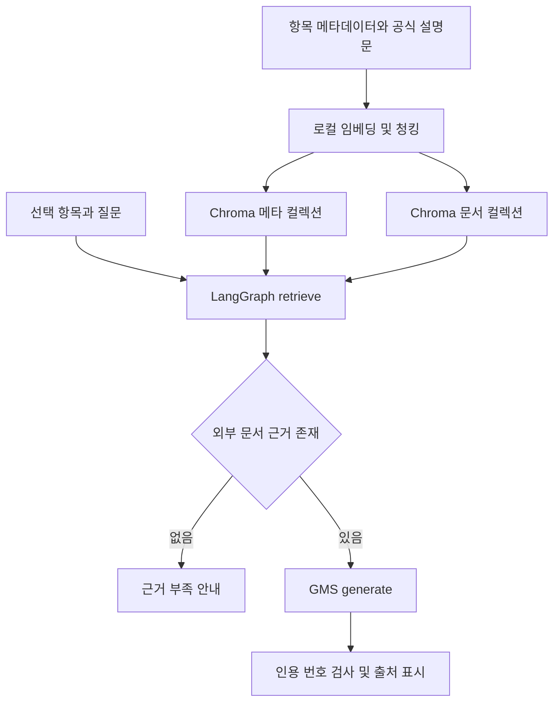

# RAG 파이프라인 설계

## 컬렉션

- android_meta_<embedding fingerprint>: 항목당 1개. ID는 항목 ID. 소개는 직접 작성한 메타데이터.
- android_docs_<embedding fingerprint>: 외부 원문 청크. ID는 항목 ID + URL 해시 + 본문/청킹 설정 해시 + 청크 순번.
- 임베딩 제공자·모델·엔드포인트가 바뀌면 다른 컬렉션을 사용해 서로 다른 벡터 공간의 혼합을 방지.
- 외부 청크 메타데이터: item_id, item_name, group_id, title, url, author, license, license_url, license_basis, collected_at, changes, notices, source_type, chunk_index.

## 초기 적재

1. 112건 항목 메타데이터 로드.
2. 속성을 합친 텍스트를 다국어 SentenceTransformer로 임베딩.
3. Chroma의 항목 컬렉션 upsert.
4. 수집된 원문 JSON을 글자 기준 재귀 분할.
5. 외부 문서 컬렉션에 청크와 출처를 적재.

## 질문 시 수집(선택)

1. 선택 항목 원문을 항상 먼저 수집/캐시 재사용.
2. 프롬프트 1이 JSON 검색어를 생성. 프로그램이 항목 이름도 추가.
3. 현재 허용 목록에서 문자열 관련도 기준 후보 8건을 구성.
4. 프롬프트 2가 후보 ID를 JSON으로 선별. 프로그램이 목록 밖 ID를 제거.
5. 선별 문서를 현재 선택 항목에 연결해 수집/색인. 성공한 검색어와 선별 결과를 캐시.

현재 3번은 전체 웹 검색이 아니라 고정 공식 문서 카탈로그 안에서의 후보 검색입니다.

## LangGraph

START → retrieve → generate → END

- retrieve: 선택 항목의 메타데이터를 반드시 포함하고, item_id로 제한하여 공식 문서 청크를 코사인 유사도로 검색. 거리 기준을 넘으면 제외하고 텍스트 해시로 중복 제거.
- generate: 공식 문서 근거가 하나도 없으면 호출 없이 근거 부족 안내. 있으면 프롬프트 3과 번호가 붙은 근거를 GMS에 전달.
- 후처리: [근거 N]을 파싱. 유효하게 인용한 근거만 UI 표시. 범위 밖 번호가 나오면 해당 답변을 표시하지 않음.
- 번호 검사는 실제 문장이 원문에 의해 뒷받침되는지 판단하는 검증과는 다름.

## 프롬프트

1. 검색어 추출: Android 문서 전문가. 출력 {"queries": ["..."]}.
2. 후보 선별: Android 문서 큐레이터. 출력 {"ids": ["..."]}.
3. 답변 생성: 자료에만 근거해 한국어 설명, 주요 주장에 [근거 N], 부족하면 확인되지 않는다고 답변.
4. 조건 탐색 보조: 메타데이터 후보 중 조건 확인 가능한 항목만 선별. 출력 {"matches":[{"id":"...", "reason":"..."}]}.

## 설정 근거와 한계

- 900자/150자 중복: 첫 버전의 문맥 보존을 위한 초기값. 대표 질문으로 조정해야 함.
- 외부 Top-k 4: 모델에 보내는 문맥과 검색량의 초기 절충. 메타데이터 1건은 별도 추가.
- cosine 거리 0.85: 근거 부족 시 억지로 검색 결과를 넣지 않기 위한 초기값. 정답 확률이 아님.
- 기본 모델은 다국어 MiniLM, 기본 최대 입력 길이가 짧아 긴 청크는 임베딩 시 뒷부분이 잘릴 수 있음. 긴 API 문서 평가 시 청크를 줄이거나 토큰 기반 청킹·더 긴 입력 모델로 개선 필요.
- 전체 대화가 아니라 최근 6개 메시지를 맥락으로 전달. 이력은 사실 근거로 취급하지 않음.
- 캐시 만료/자동 갱신은 미구현. 공식 문서 변경이 의심되면 data/raw의 해당 URL 캐시와 검색어 캐시를 지우고 재수집·색인.

## 전체 데이터 흐름

선택 수집은 질문 처리 전에 수행한다. 수집 기능은 고정 허용 목록을 사용하며 인터넷 전체를 검색하지 않는다.

## 저장 구조와 데이터 계약

| 저장 위치 | 역할 | 주요 필드 |
|---|---|---|
| data/items.json | 직접 작성한 학습 항목 | id, name, category, level, description, keywords, url, author, license |
| data/raw/*.json | 수집 원문 및 권리 고지 | title, url, text, author, license, license_url, license_basis, collected_at, changes, notices |
| storage/chroma | 검색 벡터 및 메타데이터 | 항목 ID, 청크 ID, source_type, 원문 주소, 청크 순번 |
| data/collection_cache.json | 성공 수집 검색어 캐시 | 항목 및 검색어에 따른 선별·제외 결과 |
| Streamlit session_state | 세션 내 대화 | 항목 ID별 사용자 질문·답변·출처 스냅샷 |

원문 파일은 URL 해시로 구분한다. 동일 원문이라도 청크 ID에 연결 대상 항목을 포함해 서로 다른 항목의 근거가 덮어써지지 않게 한다.

## 실패와 갱신 처리

- 키·주소·모델 설정이 비어 있거나 메타 색인이 없으면 질문 입력을 비활성화한다. 세 설정이 존재한다는 검사와 실제 API 연결 성공은 다르다.
- 허용 URL 검증, robots 확인, 30초 수집 타임아웃, 재시도 및 1.5초 요청 간격을 적용한다.
- 수집에 실패하면 성공 캐시로 기록하지 않는다. 사용자 화면에는 일반화된 오류를 안내한다.
- settings.toml의 청크 크기/중복을 변경하면 재색인이 필요하며, 새 청크 적재 뒤 오래된 청크를 제거한다.
- 원문 HTML 서식·코드는 보존하지 않는다. 공식 웹페이지와 같은 문단 구성이나 코드 학습 지원은 이번 버전의 완료 범위에 포함하지 않는다.
- GMS에 질문, 최근 대화 일부, 검색된 본문이 전달된다. 민감한 개인 정보나 비밀 키를 질문에 입력하지 않는다.
